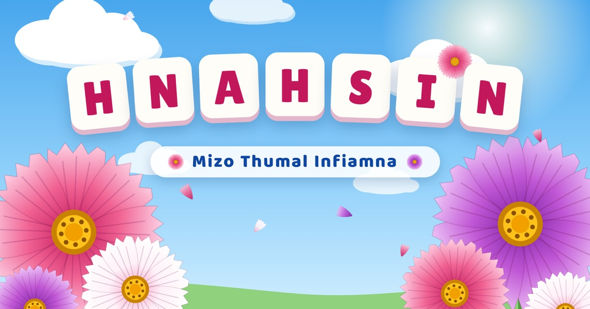

# Hnahsin Games

Learn Mizo words by playing. Free, on any phone, no sign-up.

**Play here: https://thadomaloma.github.io/hnahsin-play/**

## What you can play

- **Rova's Journey.** Rova runs across Mizoram, from the hills to Phawngpui.
  Jump into the door with the right Mizo word. Five levels, with Mizo
  sayings (tawng upa) and sentences at the end of each level.
- **Hnahsin Playground.** 10 games:
  - word quests: Word dungeon (beat monsters with Mizo words), Crossword cave
    (a crossword that lights up word by word)
  - word puzzles: Odd One Out, Spelling, Word Search, Word Chain (take turns
    with Rova), Crossword
  - everyday Mizo: Picture Match
  - sentences and sayings: Tawng Upa (what old Mizo sayings mean), Sentence
    Builder
  All but the two word quests have a level of their own that rises as you get
  better, and three ways to play: Practice, Classic and Speed.
- **Touch and learn.** Things you can tap, turn and play with, to learn their
  Mizo names, with Find it to test yourself. Zokhua: an old Mizo village as at
  Falkawn, with its stockade and gate, the chief's house and the zawlbuk, the
  adviser's and ordinary houses, the forge and the memorials, each to visit
  with its story, by day or evening. Also La siam: nu makes thread from cotton
  in six steps, from the cotton gin to the warp. Puan tah: pi weaves a Mizo
  puan on her loom, with every tool named, and the five famous Mizo puans to
  learn about and weave. Bazar dâwr: Rova shops at a market stall from a list
  in Mizo numbers. And Kumtluang: a year in an old Mizo village as one long
  picture, January to December, to drag through or play: the forest cut, burnt
  and sown, the rice weeded in the rains, standing in the mist, harvested and
  threshed, with each month's weather and festival (Pâwlkut, Chapchar Kut, Mim
  Kut, Khuangchawi), the month's name in English and Mizo at the top, and the
  name of anyone or anything you tap.
- **Aizawl Ride.** Ride a scooter along real Aizawl roads to deliver a parcel:
  from Millennium Centre to Civil Hospital, or down past Vanapa Hall and the
  Assembly House to Chawnga Road, in 3D. The bends, hills, hillsides and houses
  come from OpenStreetMap and Copernicus elevation data. Mizo words come up for what
  you ride past. Your points open four scooter designs (everyday, classic,
  sport and electric) and colours named by Mizo colour words. Every day brings
  three new missions; deliveries win up to three stars; medals and stars raise
  your rider rank, and each rank adds to your scores. Coins buy the rider a
  helmet, a jacket and a delivery box (even one in a Mizo puan's stripes), and
  every ride ends with a Mizo word to answer. Tips show you how to play on your
  first rides; the game can be played in Mizo or in English; and the scooter,
  the wind and the birds have their own sounds. Ride at night (by Aizawl's own
  clock) under the street lamps, or in the rain; at Krismas the town is hung with
  stars and lights, and at Chapchar Kut with flags, each with a prize to win. On the Aizawl map you deliver
  between 26 veng along real roads, past houses at their real heights; more
  veng open as your points grow. Share the road with cars, buses and bikes,
  wait your turn in traffic jams and stop for people at zebra crossings, the
  Aizawl way.

A **word of the day** on the home page: tap the card to see what it means.

## Words

- 2,027 core Mizo words (the 2,000 most used, and 27 everyday ones), each
  with an example sentence; 1,755 sentences and 203 sayings
- their meanings from J.F. Laldailova's English–Lushai Dictionary
- pictures from Noto Emoji, OpenMoji, game-icons.net, Healthicons and
  Microsoft's Fluent Emoji (see [CREDITS.md](CREDITS.md))

## Put it on your phone

The games work like an app and play without internet after the first visit.

- **iPhone:** open the link in Safari and tap **Add Hnahsin to your Home Screen**: a short
  guide shows the three taps (Share, Add to Home Screen, Add).
- **Android:** open the link in Chrome and tap **Install Hnahsin**.

## Privacy

The site counts which pages and games are opened and won, with
[GoatCounter](https://www.goatcounter.com/). It uses no cookies and keeps
nothing that tells who you are. Your stars and levels stay on your phone.

## For developers

The pages are plain HTML, CSS and JavaScript, served by GitHub Pages.
The sources and build scripts they are made from are kept private.

## Versions and feedback

- What changed in each version: [CHANGELOG.md](CHANGELOG.md) and
  [Releases](https://github.com/thadomaloma/hnahsin-play/releases).
- Found a wrong word, a broken game or have an idea?
  [Open an issue](https://github.com/thadomaloma/hnahsin-play/issues/new/choose).
- Where the words, pictures and tools come from: [CREDITS.md](CREDITS.md).

## Copyright

© 2026 Maloma Thado. All rights reserved.

You are welcome to play the games. Please do not copy the code, words,
pictures or design into another site or app without asking first.

Developed by Maloma Thado.
